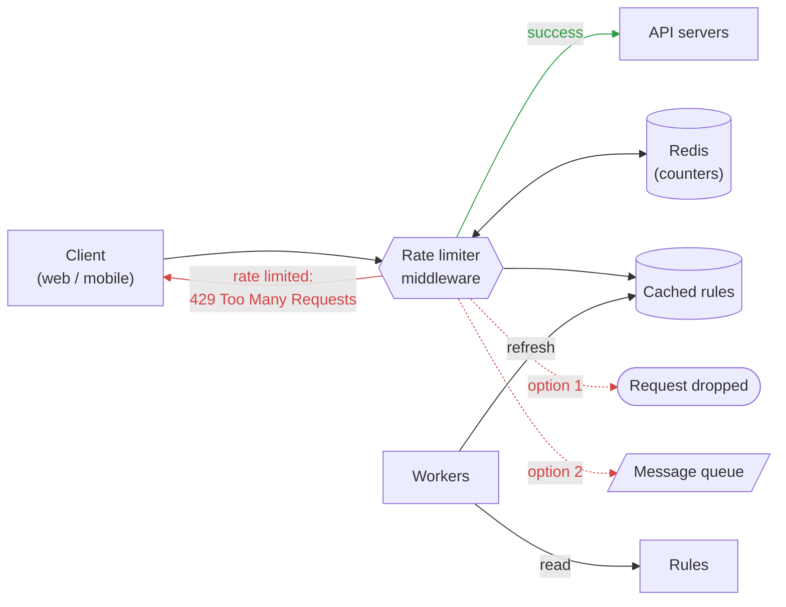

# Rate Limiter Architecture

## Request flow

1. The client sends a request to the **rate limiter middleware**.
2. The middleware looks up the rule for the request in the **cached rules**.
3. It increments the client's counter in **Redis** and compares it with the rule's limit.
4. Under the limit: the request is forwarded to the **API servers**.
5. Over the limit: the client gets **`429 Too Many Requests`**, and the request is either
   - **dropped** (option 1), or
   - **sent to a message queue** to be processed later (option 2).

In the background, **workers** periodically read the **rules** from disk and refresh the cache,
so rule changes take effect without restarting the middleware.
